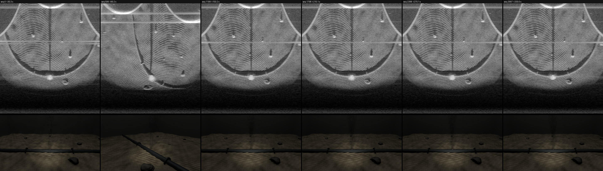
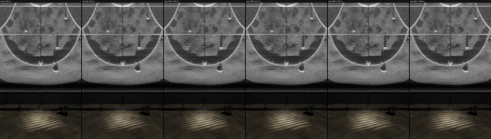
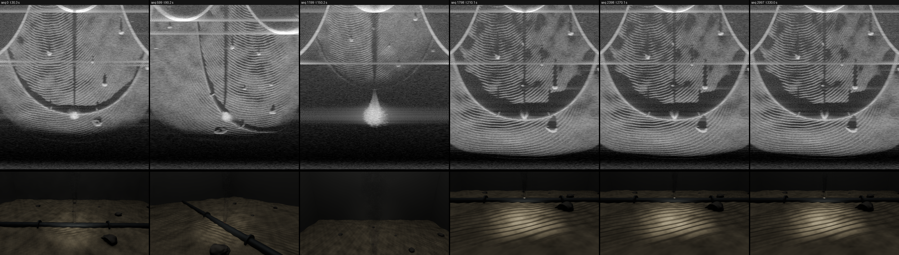

# Recording runs

Run with `output\hil\record_all.bat` (tracked as `hil\win\record_all.bat`) on branch m8a-record (commit 375bea4), 2026-11-11. The data (~58 GB) and the videos stay on the workstation under `output/records/`; this folder keeps the report and the contact sheets only.

Note: the trajectories are shorter than the 300 s runs (circle 105 s, updown 60 s, combined 167 s); after the end the ROV holds its last pose.

| run | exit | reason | sim s | wall s | RTF | GPU MiB | sonar | left | right | gt | L-R max ms | cam-sonar mean / max ms | GB (est.) |
|---|---|---|---|---|---|---|---|---|---|---|---|---|---|
| 20261111_1548_circle | 0 | duration | 300.0 | 1650 | 0.182 | 7135 | 3000 | 2998 | 2998 | 2998 | 0.000 | 0.0 / 0.0 | 19.12 (19.04) |
| 20261111_1548_updown | 0 | duration | 300.0 | 1470 | 0.204 | 7071 | 3000 | 2998 | 2998 | 2998 | 0.000 | 0.0 / 0.0 | 19.78 (19.04) |
| 20261111_1548_combined | 0 | duration | 300.0 | 1786 | 0.168 | 7487 | 3000 | 2998 | 2998 | 2998 | 0.000 | 0.0 / 0.0 | 19.44 (19.04) |

## 20261111_1548_circle (circle)

- ground truth: 149980 bubbles per frame on average
- videos (10 fps = sim real time): `output/records/20261111_1548_circle/video/camera_left.mp4`, `output/records/20261111_1548_circle/video/camera_right.mp4`, `output/records/20261111_1548_circle/video/combined.mp4`, `output/records/20261111_1548_circle/video/sonar_fan.mp4`

## 20261111_1548_updown (updown)

- ground truth: 149980 bubbles per frame on average
- trajectory note: updown: z range [-1.10, 1.90] m reaches below the floor bound 0.73 m; shifted up by 1.83 m (amplitude kept)
- videos (10 fps = sim real time): `output/records/20261111_1548_updown/video/camera_left.mp4`, `output/records/20261111_1548_updown/video/camera_right.mp4`, `output/records/20261111_1548_updown/video/combined.mp4`, `output/records/20261111_1548_updown/video/sonar_fan.mp4`

## 20261111_1548_combined (combined)

- ground truth: 149980 bubbles per frame on average
- trajectory note: updown: z range [-1.10, 1.90] m reaches below the floor bound 0.73 m; shifted up by 1.83 m (amplitude kept)
- videos (10 fps = sim real time): `output/records/20261111_1548_combined/video/camera_left.mp4`, `output/records/20261111_1548_combined/video/camera_right.mp4`, `output/records/20261111_1548_combined/video/combined.mp4`, `output/records/20261111_1548_combined/video/sonar_fan.mp4`

